# iptv-tui

AI-native terminal IPTV client for M3U playlists and Xtream Codes portals. Browse live/VOD/series, then play through `mpv`.


## Screenshots

All shots use pseudo demo data (`Demo XC` source). Regenerate with
`IPTV_TUI_GEN_SHOTS=1 go test ./internal/tui/ -run TestGenShots` plus
`python3 docs/screenshots/render.py` (Pillow).

| Movies with resume meter | EPG guide |
|---|---|
| 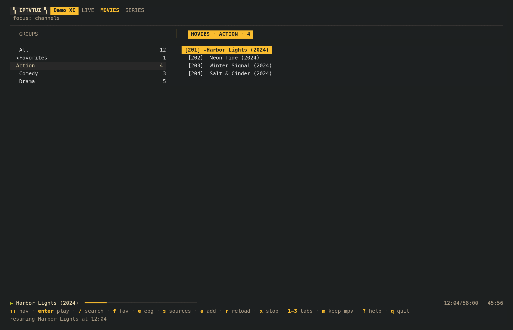 | 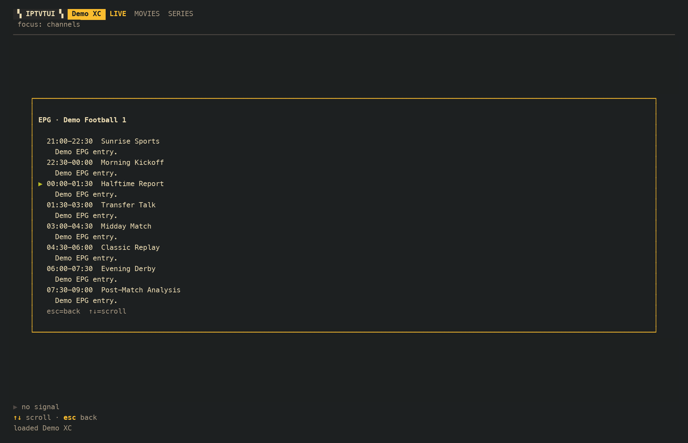 |

| Series episodes | Key bindings |
|---|---|
| 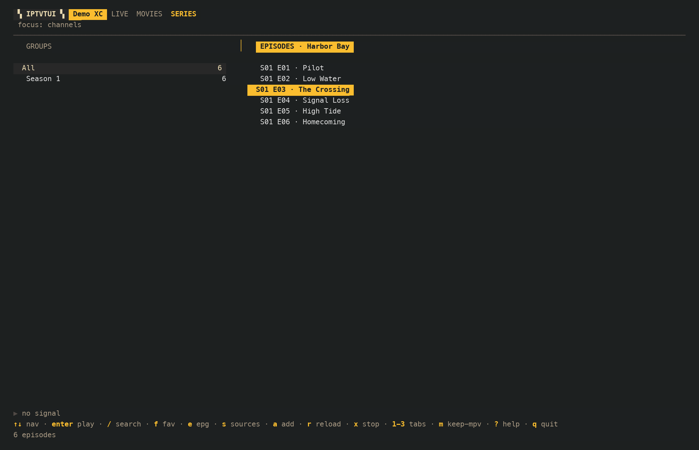 | 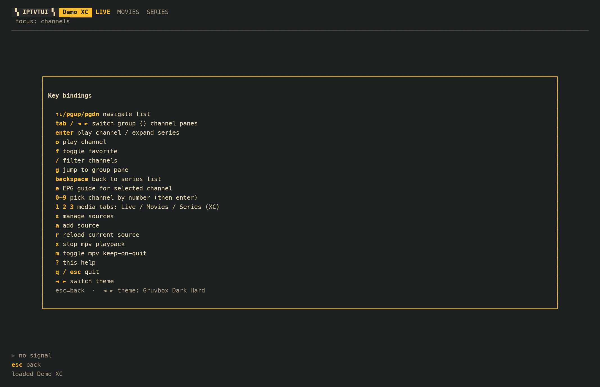 |

| No player found |
|---|
| 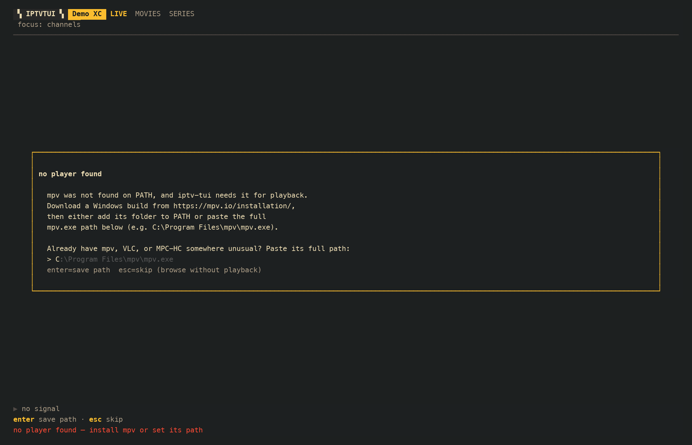 |

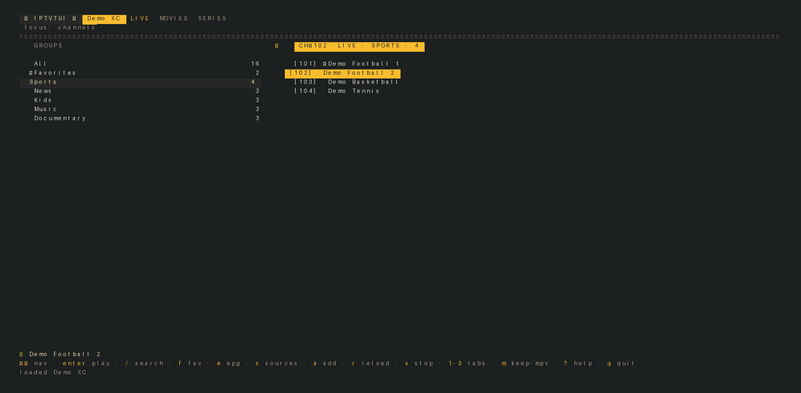

## Requirements

- Go 1.27+
- `mpv` on `PATH` (https://mpv.io), or set an absolute path in settings

## Install

Pick your OS. All three put an `iptv-tui` command on `PATH` so you run it
bare (no `./` prefix).

### macOS

```sh
brew install go mpv
go install github.com/mertturunc/iptv-tui@latest
```

If `command -v iptv-tui` finds nothing, add Go's bin dir to your shell once:

```sh
echo 'export PATH="$HOME/go/bin:$PATH"' >> ~/.zshrc && source ~/.zshrc
```

### Linux

Install Go 1.27+ (package manager or go.dev) and mpv (package manager), then:

```sh
go install github.com/mertturunc/iptv-tui@latest
echo 'export PATH="$HOME/go/bin:$PATH"' >> ~/.bashrc && source ~/.bashrc
```

### Windows

Install Go 1.27+ (go.dev) and mpv (https://mpv.io), then in PowerShell:

```powershell
go install github.com/mertturunc/iptv-tui@latest
```

The binary lands at `%USERPROFILE%\go\bin\iptv-tui.exe`. If `where iptv-tui`
finds nothing, add that folder to your user `PATH` once (new terminal after):

```powershell
[Environment]::SetEnvironmentVariable('Path', $env:Path + ';$HOME\go\bin', 'User')
```

### No Go? Prebuilt binary

No Go toolchain needed: download the zip for your OS from
https://github.com/mertturunc/iptv-tui/releases, unzip, and place the binary
on `PATH` (`/usr/local/bin` or `~/.local/bin` on macOS/Linux; any `PATH` folder
on Windows). Verify with `SHA256SUMS` from the same release.

Build all release zips + `SHA256SUMS` into `dist/`:

```powershell
.\build-release.ps1
```

## Usage

```sh
iptv-tui              # launch the TUI
iptv-tui -play <url>  # play a URL/file directly with mpv, then exit
iptv-tui -add-source <m3u-url>  # add an M3U source, then exit
iptv-tui -version
iptv-tui -ascii       # plain-ASCII rendering (also IPTV_TUI_ASCII=1)
```

TUI keys (see `?` in-app):

- `up/down` (`j`/`k`), `pgup/pgdn`: navigate · `tab`, `left/right` (`h`/`l`): switch group/channel panes · `g`: jump to group pane · `[`/`]`: prev/next media tab
- `enter`/`space`: play channel / expand series · `o`/`p`: play (expands a series container, which has no direct stream) · `c`: send to TV (Chromecast) · `v`/`A`: send to Apple TV (AirPlay) · `f`: favorite · `/`: filter · `*`: favorite
- `tab`, `left/right`: switch season/episode panes inside a series · `backspace`/`esc`: back to series list (also clears a pending number entry)
- `e`/`i`: EPG · `#` or `0-9` + `enter`: jump by channel number · `1/2/3`: Live/Movies/Series (Xtream)
- `s`/`S`: sources · `a`/`n`/`+`: add source · `k` in add form: toggle m3u/xtream · `d` in sources: delete source · `r`/`R`: reload · `x`/`X`: stop mpv and TVs (mpv first) · `m`/`K`: keep-mpv-on-quit · `q`/`Q`: quit
- `?`/`F1`: help · `↑/↓` inside help: scroll bindings when they overflow · `←/→` inside help: switch theme · `esc`: back

Player settings (`MpvPath`, `MpvArgs` one-per-line, `DefaultUserAgent`) live in config.json alongside `KeepMpvOnQuit`, `Theme`, `CastTV`, and `AirPlayTV`.

Playback position is tracked for VOD/series and resumed with `--start` on next launch.
That needs `mpv`: without it the app falls back to VLC, then MPC-HC, which play
fine but report no position, so there is no duration meter and no resume
(VLC accepts a start offset only from API callers; TUI plays via VLC always start at 0).
If the playbar says `waiting for player…`, the mpv link never came up.

## Send to TV (Chromecast)

Press `c` on any channel to send it to a Google TV on your network. The sheet
scans the LAN for cast receivers (pick with `up/down`, rescan with `r` on an
empty address field), or type the TV address by hand. `enter` casts the typed
address, the picked TV, or the last TV in that order; `x` in the main view
stops the TV (it stops mpv first when both run). The last good TV is
remembered in settings. The TV keeps playing after you quit, like
keep-mpv-on-quit — except proxied casts below, which end with the process
serving them.

How it travels: except DASH (`.mpd`), the stream is proxied through this
machine, so provider headers (User-Agent, Referer) are injected server-side
and throughput is measured, not guessed. The player API additionally accepts
an `Origin` and extra headers for providers that need more than UA/Referer
(`player.Request.Origin`/`ExtraHeaders`, sent as mpv `--http-header-fields`);
the TUI itself only fills User-Agent/Referer today. HLS playlists are rewritten so
segments stay behind the proxy. DASH casts direct: the TV pulls the origin
itself with no headers and no bitrate. On first use the OS asks to allow the
local listener through the firewall. The sheet shows the advertised address
and the TV's pull count, so a TV that never connects (IDLE, zero pulls)
points at firewall or routing instead of the stream. Casting onto a TV that
is already running a session restarts it first, and receiver polls are
serialized so overlapping cast/stop operations never interleave on the wire.

While casting, the sheet shows a buffer dashboard from receiver status polls
every 2s: state (`PLAYING`/`BUFFERING`/…), position, rate, and poll time in
text, plus a state ribbon (alarmed `!` spells) and a proxy-throughput
sparkline in graph. Drift (wall-clock minus media-time) and a stall counter
complete the picture; the playbar carries state, position, and Mbps
at a glance. Honest limits: receivers never report download speed, so the
Mbps number is measured proxy throughput — direct casts show none.

## Send to TV (AirPlay)

Press `v` on any channel to send it to an Apple TV on your network. The sheet
works like the Chromecast one: it scans the LAN for AirPlay receivers (pick
with `up/down`, rescan with `r` on an empty address field), or type the TV
address by hand. `enter` plays on the typed address, the picked TV, or the
last TV in that order; `x` in the main view stops the Apple TV (it stops mpv
first when both run). The last good TV is remembered in settings. The TV keeps
playing after you quit, like keep-mpv-on-quit — except proxied plays below,
which end with the process serving them.

How it travels: the same proxy as Chromecast, so provider headers
(User-Agent, Referer) are injected server-side and throughput is measured, not
guessed. HLS playlists are rewritten so segments stay behind the proxy; DASH
(`.mpd`) plays direct, with no headers and no bitrate. While playing, the
sheet polls `/playback-info` every 2s for state and position, with the same
proxy-throughput sparkline as Chromecast. Honest limits: AirPlay video is the
unauthenticated (v1) protocol, so the TV must allow everyone — a TV with an
AirPlay password answers 401, a TV gating the handshake answers 403, and the
app says what to change in the TV's AirPlay settings instead of failing
silently. Sets with no `/play` endpoint at all (many Roku/TCL/Google TV
models) speak AirPlay 2 only, which this client does not implement — the app
names that too.

## Themes

8 palettes: Gruvbox Dark Hard (default), Dracula, Nord, Tokyo Night,
Gruvbox Light Hard, Solarized Light, One Light, Catppuccin Latte.
Preview with `←/→` in the help sheet; the choice is saved and restored on boot.
The frame paints every cell and tints the window background, so no
terminal-default gap survives a switch; the tint is removed on exit.
All pairs hold WCAG AA (text 4.5, accents 3.0 — see `TestThemeContrast`).

| Gruvbox Dark Hard | Dracula |
|---|---|
| 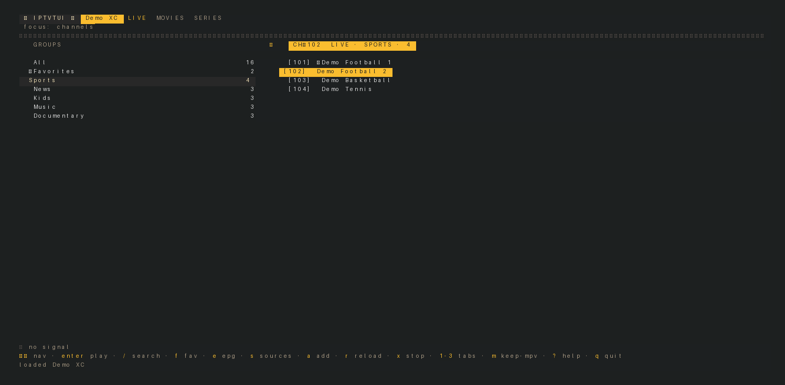 | 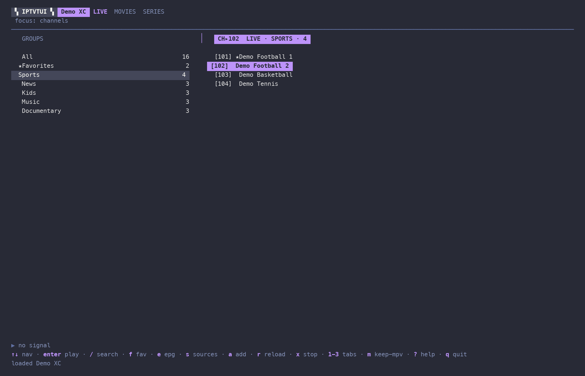 |

| Nord | Tokyo Night |
|---|---|
| 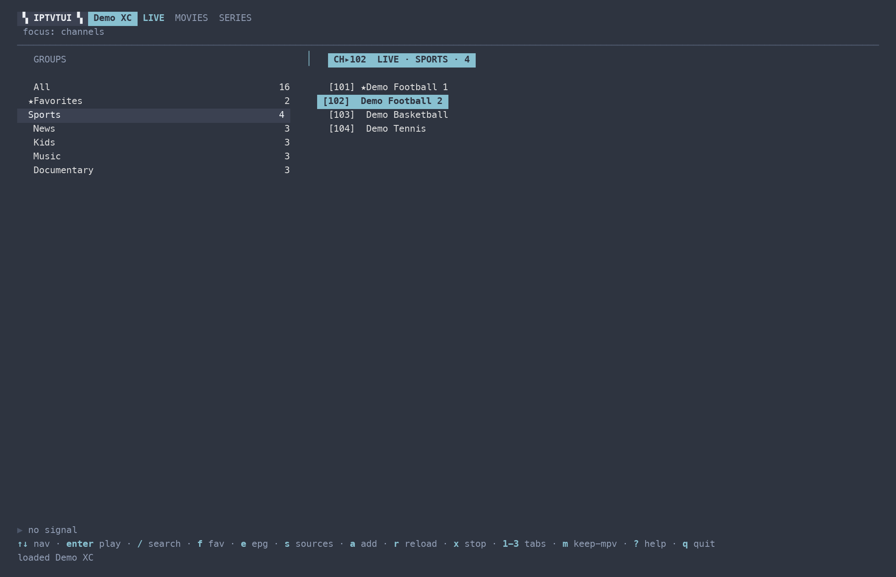 |  |

| Gruvbox Light Hard | Solarized Light |
|---|---|
| 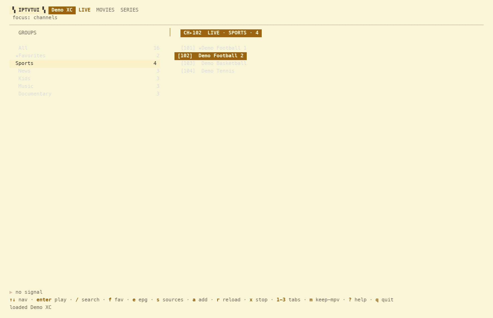 | 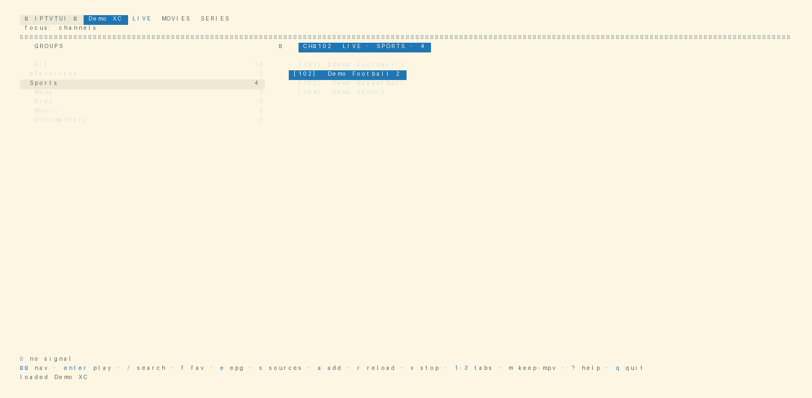 |

| One Light | Catppuccin Latte |
|---|---|
| 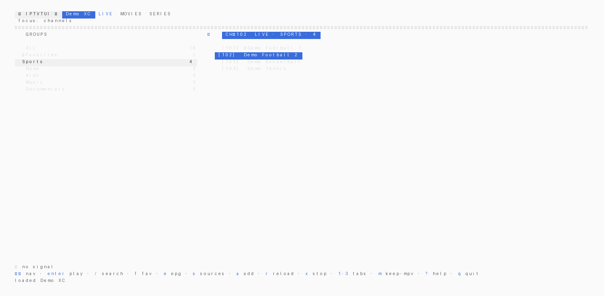 | 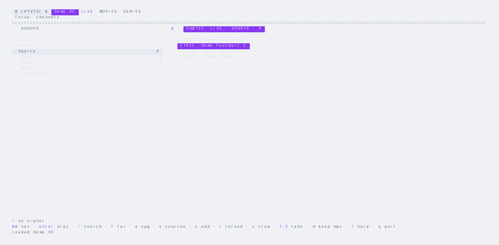 |

## Data

Created on first run:

- Windows: `%AppData%\iptv-tui`
- Linux: `~/.config/iptv-tui` (cache: `~/.cache/iptv-tui`)
- macOS: `~/Library/Application Support/iptv-tui`

Source lists and EPG indexes are cached to disk, so startup works offline and is instant; stale snapshots trigger a background refresh.

## Layout

- `main.go`: flags, direct-play and add-source entry points
- `internal/m3u`: M3U parser
- `internal/xtream`: Xtream Codes API client
- `internal/load`: source fetching, normalization, disk snapshots
- `internal/epg`: XMLTV parsing, short/index EPG caches
- `internal/player`: `mpv` launch, IPC position tracking
- `internal/cast`: Chromecast send-to-TV (LAN scan, Castv2 sender, LAN proxy
  with HLS rewrite, receiver status polling, no cgo)
- `internal/airplay`: AirPlay send-to-TV (LAN scan, v1 HTTP play/stop/status,
  no pairing; reuses the `cast` LAN proxy for headers and bitrate)
- `internal/store`: config, favorites, history (mutex-guarded; snapshots for background use)
- `internal/tui`: Bubble Tea UI (`tui` shell/chrome, `modes` dispatch table,
  `update` main keys, `view` paint, `playback`, `series`, `epgview`,
  `sources`, `cast`, `airplay`, `overlays`, `theme`)
- `build-release.ps1`: release packaging

## Development

```sh
go vet ./...
go test ./...
gofmt -l .
```

Guardrails: CI (`.github/workflows/ci.yml`) runs fmt, vet, the full suite,
and windows/darwin cross-compiles on every push. A pre-commit hook runs the
fast subset (fmt + vet) locally — enable it once per clone:

```sh
git config core.hooksPath .githooks
```

Full `go test ./...` stays out of the hook on purpose: `TestInitClearsLog`
overrides `$HOME`, which `os.UserConfigDir` ignores on macOS, so the suite
is red on darwin through no fault of the tree.

Debug logging: `IPTV_TUI_DEBUG=1 iptv-tui` (also `true`/`yes`/`on`; anything else stays off) clears
`<configDir>/iptv-tui/player-debug.log` on boot, prints its path, and records
the cast path end to end (scan results, dial/launch/LOAD outcomes, receiver
states, proxy pulls and byte counts, stop confirmation). Stream URLs embed
provider credentials, so the log only ever carries their host plus shape —
safe to share as-is.